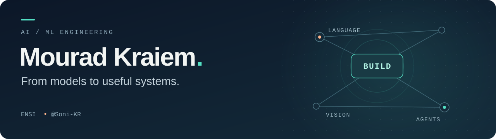

  

  <a href="https://mouradkraiem.vercel.app"><strong>Portfolio</strong></a>
  &nbsp;&nbsp; / &nbsp;&nbsp;
  <a href="https://www.linkedin.com/in/mourad-kraiem-99a0952a1/"><strong>LinkedIn</strong></a>
  &nbsp;&nbsp; / &nbsp;&nbsp;
  <a href="mailto:mourad.kraiem@ensi-uma.tn"><strong>Say hello</strong></a>

I'm a computer science engineering student at **ENSI**, building across **language models, computer vision, and intelligent systems**. I like projects where an experiment becomes something people can actually use: a clinical workflow, a grounded answer, or a game you can play.

## Selected builds

<table>
<tr>
<td width="50%" valign="top">
<h3>01 / PCDent</h3>

<strong>Computer vision meets clinical workflows.</strong>

A team-built dental assistance prototype with radiograph segmentation, AI-assisted reports, real-time messaging, and dentist review.

YOLO · PyTorch · Django · React · PostgreSQL

<a href="https://github.com/Soni-KR/pcdent"><strong>Explore the system →</strong></a>
</td>
<td width="50%" valign="top">
<h3>02 / AI Detective</h3>

<strong>Ask questions. Find contradictions. Solve the case.</strong>

An interactive mystery game with LLM-powered suspects and a deterministic evidence engine that keeps the story grounded.

Next.js · TypeScript · React · OpenRouter

<a href="https://github.com/Soni-KR/ai-detective"><strong>Open the case files →</strong></a>
</td>
</tr>
<tr>
<td width="50%" valign="top">
<h3>03 / MG-Retriever</h3>

<strong>Arabic medical QA with a trail of evidence.</strong>

A Graph-RAG research prototype combining lexical, vector, and graph retrieval with citations and claim verification.

Python · Neo4j · Sentence Transformers · Docker

<a href="https://github.com/Soni-KR/Explainable-G-RAG-Arabic-Medical-QA"><strong>Follow the evidence →</strong></a>
</td>
<td width="50%" valign="top">
<h3>04 / Small model, better summaries</h3>

<strong>Fine-tuning with a small parameter budget.</strong>

A LoRA experiment on SmolLM2-135M: ROUGE-L improved from <strong>20.42 to 36.71</strong> on 500 DialogSum test dialogues.

PyTorch · Transformers · PEFT · TRL

<a href="https://github.com/Soni-KR/lora-dialogue-summarization"><strong>Inspect the experiment →</strong></a>
</td>
</tr>
</table>

## A little deeper

- **[Graphs + agents](https://github.com/Soni-KR/Improving-News-Prediction-through-Multi-Agent-Systems)** — an internship project exploring country–disease link prediction from Arabic health news.
- **[Depth from a single image](https://github.com/Soni-KR/AIGOAT1.0-Task2-Monocular-Depth-Estimation-from-Single-RGB-Images-solution)** — a monocular depth estimation solution with ONNX inference, FastAPI, and React.
- **[Agent Check](https://github.com/Soni-KR/agent-check)** — a local tool-using agent and evaluation lab built with Ollama, FastAPI, and React.

## What I build with

| Layer | Toolkit |
| :--- | :--- |
| **Models & experiments** | Python · PyTorch · Transformers · scikit-learn · OpenCV |
| **Language & retrieval** | LoRA / PEFT · RAG · Neo4j · LangChain · Ollama |
| **Interfaces & APIs** | TypeScript · React · Next.js · Django · FastAPI |
| **Data & delivery** | PostgreSQL · Redis · Docker · Git |

---

  <strong>Have an interesting AI problem?</strong> 
  <a href="mailto:mourad.kraiem@ensi-uma.tn">Let's talk about what we could build.</a>

