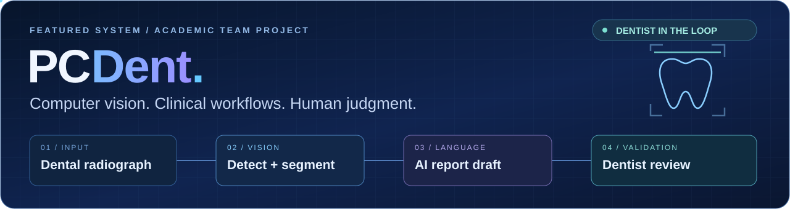

 

**AI • ML • Research • Engineering**

  
  
  
  

---

## ⚡ Featured System

A full-stack AI dental assistance platform combining **computer vision, clinical workflows, real-time communication, and AI-assisted reporting** — with the dentist reviewing the final findings.

`YOLO` · `PyTorch` · `Django` · `React` · `PostgreSQL`

[**Explore PCDent →**](https://github.com/Soni-KR/pcdent)

---

## 🧰 Tech Arsenal

### Languages

`SQL`

### AI / Machine Learning

`Transformers` · `LLMs` · `Graph Neural Networks` · `RAG` · `YOLO` · `Q-Learning`

### Web / Backend

### Data / Infrastructure

`Neo4j` · `LangChain` · `Chroma` · `ONNX` · `Celery`

---

## 🧠 Research & Learning

**[Multi-Agent News Prediction](https://github.com/Soni-KR/Improving-News-Prediction-through-Multi-Agent-Systems)**  
Multi-agent pipelines and graph neural networks for country–disease link prediction from Arabic health news.

**[⚽ Penalty Kick ML Learning Path](https://github.com/Soni-KR/penalty-kick-ml-learning-path)**  
16 practical lessons that turn football penalty data into a complete ML pipeline, from exploration to prediction.

---

**Let's build something intelligent.**

[Portfolio](https://mouradkraiem.vercel.app) · [LinkedIn](https://www.linkedin.com/in/mourad-kraiem-99a0952a1/) · [Email](mailto:mourad.kraiem@ensi-uma.tn)

